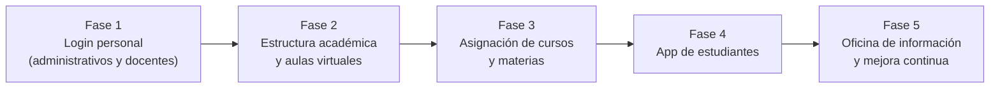

# 🏫 Segundo Cerebro — Colegio Virtual

> 🧪 **Piloto con datos ficticios** — sin producción real. Ver [[2026-10-28 Decisiones de la direccion]].
>
> Base de conocimiento para construir, con **Scrum**, la plataforma de un colegio **100 % virtual**: sin aulas físicas, con oficinas físicas solo para información y atención al público.

## 🧭 Mapa del vault

| Área | Qué encuentras | Entrada |
|---|---|---|
| 🎯 Proyecto | Visión, contexto, fases, actores, riesgos | [[Vision del producto]] |
| 🔁 Scrum | Teoría y práctica de Scrum aplicada | [[Scrum MOC]] |
| 📋 Producto | Backlog, épicas, historias de usuario, DoD, DoR | [[Backlog del producto]] |
| 🏃 Sprints | Planificación y resultados de cada sprint | [[Sprints MOC]] |
| 🏗️ Arquitectura | Dominio, roles y permisos, autenticación, ADRs | [[Vision de arquitectura]] |
| 🎨 Diseño UX | Pantallas, accesibilidad, conectividad | [[Pantalla login personal]] |
| 🗓️ Reuniones | Registro de eventos Scrum y reuniones | [[Reuniones MOC]] |
| 🧩 Plantillas | Plantillas para nuevas notas | [[Como usar este segundo cerebro#Plantillas]] |
| 📚 Recursos | Glosario, normativa, referencias | [[Glosario]] · [[Referencias]] |

## 🚦 Estado actual del proyecto

- **Fase en curso:** Fase 1 — Acceso del personal (login de plantel administrativo y docentes). Ver [[Fases y roadmap]].
- **Próximo sprint:** [[Sprint 0 - Preparacion]] (inicia el 02/11/2026); luego [[Sprint 1 - Login base]].
- **Objetivo del producto:** ver [[Vision del producto#Objetivo del producto (Product Goal)]]
- **Siguiente hito:** el personal puede ingresar de forma segura y ver su panel según su rol.

## 🗺️ Las tres grandes etapas

## ⚡ Accesos rápidos

- [[Backlog del producto]] — lista priorizada de todo el trabajo
- [[Backlog tecnico]] · [[Paquetes MOC]] — habilitadores técnicos y paquetes de trabajo por developer
- [[ADR-005 Stack PHP Laravel y Filament]] · [[Stack tecnologico]] — stack PHP 8.3 + Laravel 13 + Filament 5
- [[EP-01 Login plantel administrativo y docentes]] — épica en curso
- [[Definicion de Terminado]] · [[Definicion de Listo]]
- [[Roles y permisos RBAC]] · [[Flujo de autenticacion]]
- [[Equipo Scrum del proyecto]]
- Última revisión del backlog: [[2026-10-28 Revision del Product Owner]]
