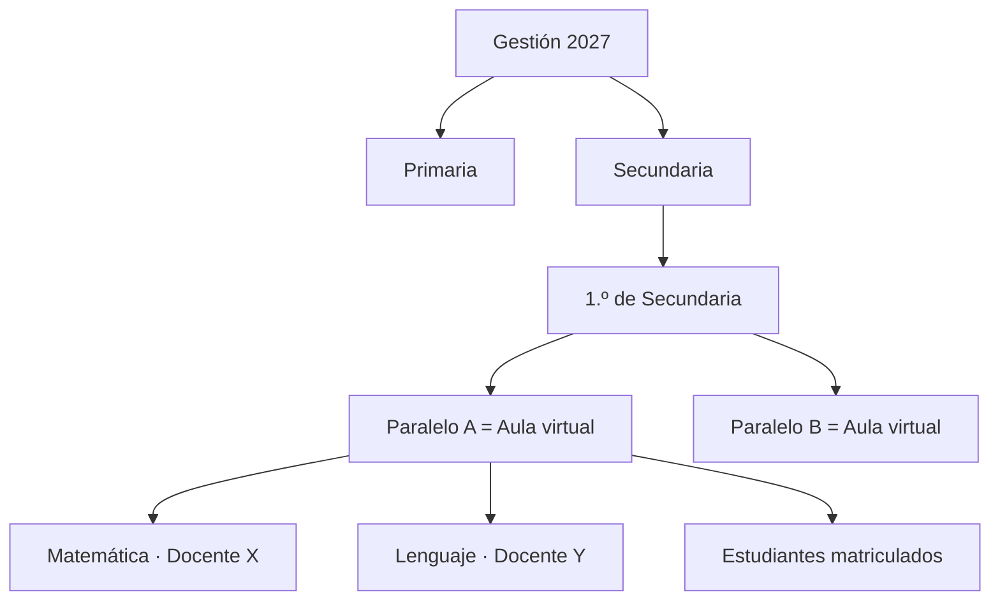

# Contexto del colegio virtual

Volver a [[Inicio]] · Relacionado: [[Vision del producto]] · [[Stakeholders]]

## Modelo del colegio
- **Netamente virtual**: no existen aulas físicas. Clases, tareas, evaluaciones y comunicación ocurren en la plataforma.
- **Oficinas físicas solo para información**: orientación a familias, consultas de inscripción, entrega de documentación. Ver [[EP-07 Oficina de informacion]].
- **Piloto** con enfoque de cooperación (proyecto *piloto boliviano-suizo*), por lo que la trazabilidad, la documentación y el aprendizaje del proceso son parte del entregable.

## Estructura académica (referencia Bolivia)
> Validar con la normativa vigente — ver [[Marco normativo Bolivia]].

- **Niveles**: Educación Inicial en Familia Comunitaria · Educación Primaria Comunitaria Vocacional · Educación Secundaria Comunitaria Productiva.
- **Gestión escolar** anual, organizada en periodos de evaluación (p. ej. trimestres).
- **Grado → Paralelo → Aula virtual**: cada paralelo de cada grado tiene un aula virtual.

## Actores y canales de acceso
| Actor | Canal | Fase |
|---|---|---|
| Plantel administrativo | Portal web del personal | 1 |
| Docentes | Portal web del personal (y móvil responsive) | 1 |
| Estudiantes | **Aplicativo de estudiantes** (móvil + web) | 4 |
| Padres / tutores | Sin acceso propio por ahora: se registran con su consentimiento ([[HU-033 Registrar estudiante y tutor]]) y reciben las credenciales del estudiante ([[HU-034 Credenciales del estudiante para el tutor]]). Acceso de consulta: por decidir | 3–4 / futuro |
| Personal de oficina de información | Portal web del personal (rol propio) | 1 / 5 |

## Restricciones y realidades
- Conectividad variable (urbana/rural); muchos usuarios con datos móviles. Ver [[Accesibilidad y conectividad]].
- Dispositivos compartidos en el hogar → importancia de cerrar sesión y expiración. Ver [[HU-002 Cerrar sesion]].
- Datos de menores de edad → protección reforzada. Ver [[Seguridad y proteccion de datos]].
- Personal con distintos niveles de alfabetización digital → interfaz simple y guías.
