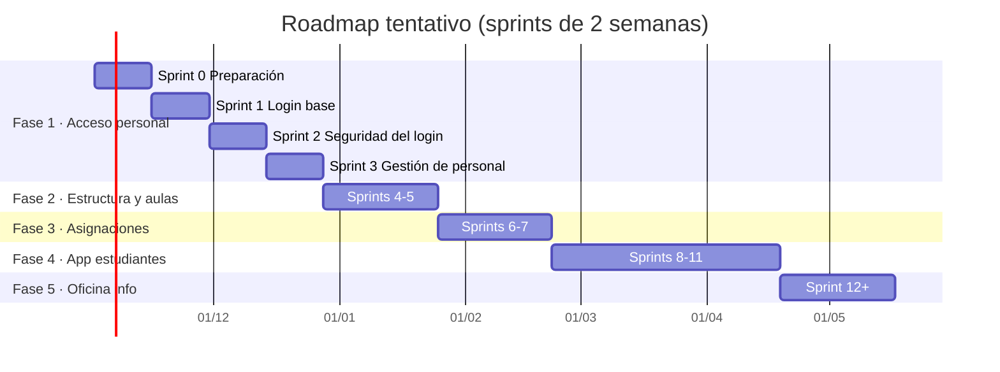

# Fases y roadmap

Volver a [[Inicio]] · [[Vision del producto]] · [[Backlog del producto]]

> El roadmap es una **previsión**, no un contrato. Se ajusta en cada [[Sprint Review]] según lo aprendido (adaptación — ver [[Pilares de Scrum]]).

## Fase 1 — Acceso del personal (en curso)
**Meta:** plantel administrativo y docentes inician sesión de forma segura y ven su panel según su rol.
- [[EP-01 Login plantel administrativo y docentes]]
- [[EP-02 Gestion de usuarios y roles]]
- [[EP-08 Seguridad y auditoria]] (parte inicial)
- Sprints: [[Sprint 0 - Preparacion]] · [[Sprint 1 - Login base]] · [[Sprint 2 - Seguridad del login]] · [[Sprint 3 - Gestion de personal]]

## Fase 2 — Estructura académica y aulas virtuales
**Meta:** gestiones, niveles, grados, paralelos y materias registrados; cada paralelo tiene su aula virtual.
- [[EP-03 Estructura academica]]
- [[EP-04 Aulas virtuales]]

## Fase 3 — Asignación de cursos y materias
**Meta:** cada aula virtual tiene sus materias y cada materia su docente; los docentes ven sus aulas al ingresar.
- [[EP-05 Asignacion de cursos y materias]]

## Fase 4 — Aplicativo de estudiantes
**Meta:** estudiantes matriculados acceden a su app y ven sus aulas y materias.
- [[EP-06 App de estudiantes]]

## Fase 5 — Oficina de información y mejora continua
**Meta:** la oficina física atiende consultas con datos de la plataforma; se incorporan reportes y mejoras.
- [[EP-07 Oficina de informacion]]

## Línea de tiempo tentativa

## Hitos
| Hito | Criterio | Fecha tentativa |
|---|---|---|
| H1 — Personal puede ingresar | HU-001..HU-007 y HU-029 terminadas (HU-008 queda primera tras la Fase 1) | Fin de Sprint 2 |
| H2 — Personal gestionado por el colegio | HU-009, HU-010, HU-011, HU-030 y HU-014 terminadas (HU-012 según tamaño del plantel) | Fin de Sprint 3 |
| H3 — Aulas virtuales listas | EP-03 + EP-04 | Fin de Fase 2 |
| H4 — Docentes asignados y estudiantes matriculados | EP-05 | Fin de Fase 3 |
| H5 — Estudiantes en la app | EP-06 (MVP) | Fin de Fase 4 |

> ⚠️ **Calendario escolar (revisión del PO, 2026-10-28):** con este roadmap la Fase 3 termina hacia marzo de 2027 y la Fase 4 hacia mayo de 2027, después del inicio habitual de clases en Bolivia (febrero). La dirección debe decidir con qué gestión arranca el colegio en la plataforma. Ver [[2026-10-28 Revision del Product Owner]].
