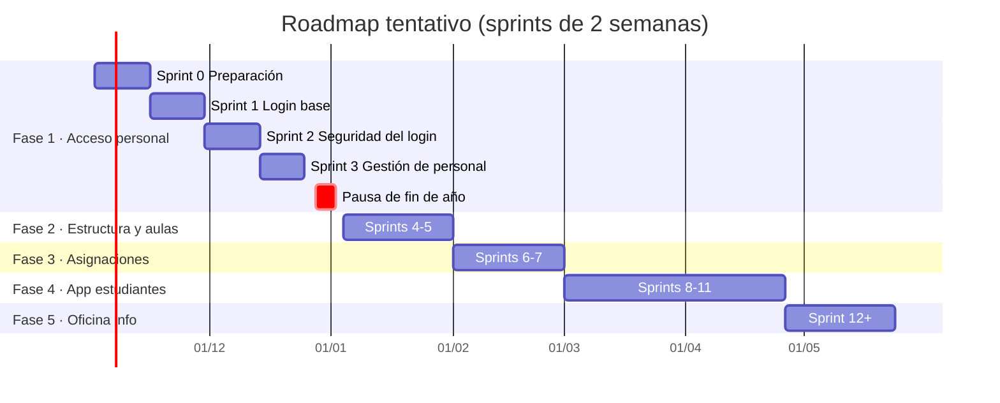

# Fases y roadmap

Volver a [[Inicio]] · [[Vision del producto]] · [[Backlog del producto]]

> 🧪 **Proyecto piloto / demostración.** No es una puesta en producción real del colegio: se trabaja con **datos 100 % ficticios** (personas, estudiantes, RUDE y correos inventados, dominio `@colegio-piloto.test`), sin despliegue a producción ni compromisos operativos reales. La **Gestión 2027** es el escenario simulado del piloto, no una fecha de salida. Ver [[2026-10-28 Decisiones de la direccion]].

> El roadmap es una **previsión**, no un contrato. Se ajusta en cada [[Sprint Review]] según lo aprendido (adaptación — ver [[Pilares de Scrum]]).

## Fase 1 — Acceso del personal (en curso)
**Meta:** plantel administrativo y docentes inician sesión de forma segura y ven su panel según su rol.
- [[EP-01 Login plantel administrativo y docentes]]
- [[EP-02 Gestion de usuarios y roles]]
- [[EP-08 Seguridad y auditoria]] (parte inicial)
- Sprints: [[Sprint 0 - Preparacion]] · [[Sprint 1 - Login base]] · [[Sprint 2 - Seguridad del login]] · [[Sprint 3 - Gestion de personal]]

## Fase 2 — Estructura académica y aulas virtuales
**Meta:** gestiones, niveles, grados, paralelos y materias registrados; cada paralelo tiene su aula virtual.
- [[EP-03 Estructura academica]]
- [[EP-04 Aulas virtuales]]

## Fase 3 — Asignación de cursos y materias
**Meta:** cada aula virtual tiene sus materias y cada materia su docente; los docentes ven sus aulas al ingresar.
- [[EP-05 Asignacion de cursos y materias]]

### 🎯 MVP del piloto (escenario: inicio de clases de la Gestión 2027)
Mínimo para **demostrar** el piloto con datos ficticios: gestión, estructura con cupos, materias, aulas, materias y docentes asignados (con carga horaria máxima), estudiantes registrados con RUDE y tutor, matrícula y "Mis aulas" con la lista de estudiantes del docente. 10 historias, 39 pts (HU-015, 016, 017, 018, 020, 021, 022, 033, 023, 031). Ver [[Backlog del producto]].

## Fase 4 — Aplicativo de estudiantes
**Meta:** estudiantes matriculados acceden a su app y ven sus aulas y materias.
- [[EP-06 App de estudiantes]]
- [[EP-09 Acceso de tutores]]

## Fase 5 — Oficina de información y mejora continua
**Meta:** la oficina física atiende consultas con datos de la plataforma; se incorporan reportes y mejoras.
- [[EP-07 Oficina de informacion]]

## Línea de tiempo tentativa

## Hitos
> Fechas de sprints confirmadas por el Scrum Master el 2026-10-28: Sprint 3 del 14/12 al 24/12/2026, pausa de fin de año del 28/12/2026 al 01/01/2027 y Fase 2 desde el 04/01/2027 ([[2026-10-28 Sprint Planning tecnico - Scrum Master]]).

| Hito | Criterio | Fecha tentativa |
|---|---|---|
| H1 — Personal puede ingresar | HU-001..HU-007 y HU-029 terminadas (HU-008 queda primera tras la Fase 1) | Fin de Sprint 2 (11/12/2026) |
| H2 — Personal gestionado por el colegio | HU-009, HU-010, HU-011, HU-030 y HU-014 terminadas (HU-012 según tamaño del plantel) | Fin de Sprint 3 (24/12/2026) |
| H3 — Aulas virtuales listas | HU-015 a HU-018 | Fin de Fase 2 |
| H3b — MVP del piloto demostrable | Las 10 historias del MVP (39 pts) | Sprints 4–5 (enero de 2027, referencial) |
| H4 — Docentes asignados y estudiantes matriculados | EP-05 | Fin de Fase 3 |
| H5 — Estudiantes y tutores en la app | EP-06 (MVP) + EP-09 | Fin de Fase 4 |

> **Calendario (actualizado):** la dirección eligió la Gestión 2027 como escenario. Como es un **piloto**, no hay fecha de salida real: el MVP se ordenó para que el escenario "inicio de clases 2027" pueda demostrarse primero, y las Fases 4–5 siguen después sin presión de calendario. Ver [[2026-10-28 Decisiones de la direccion]].
