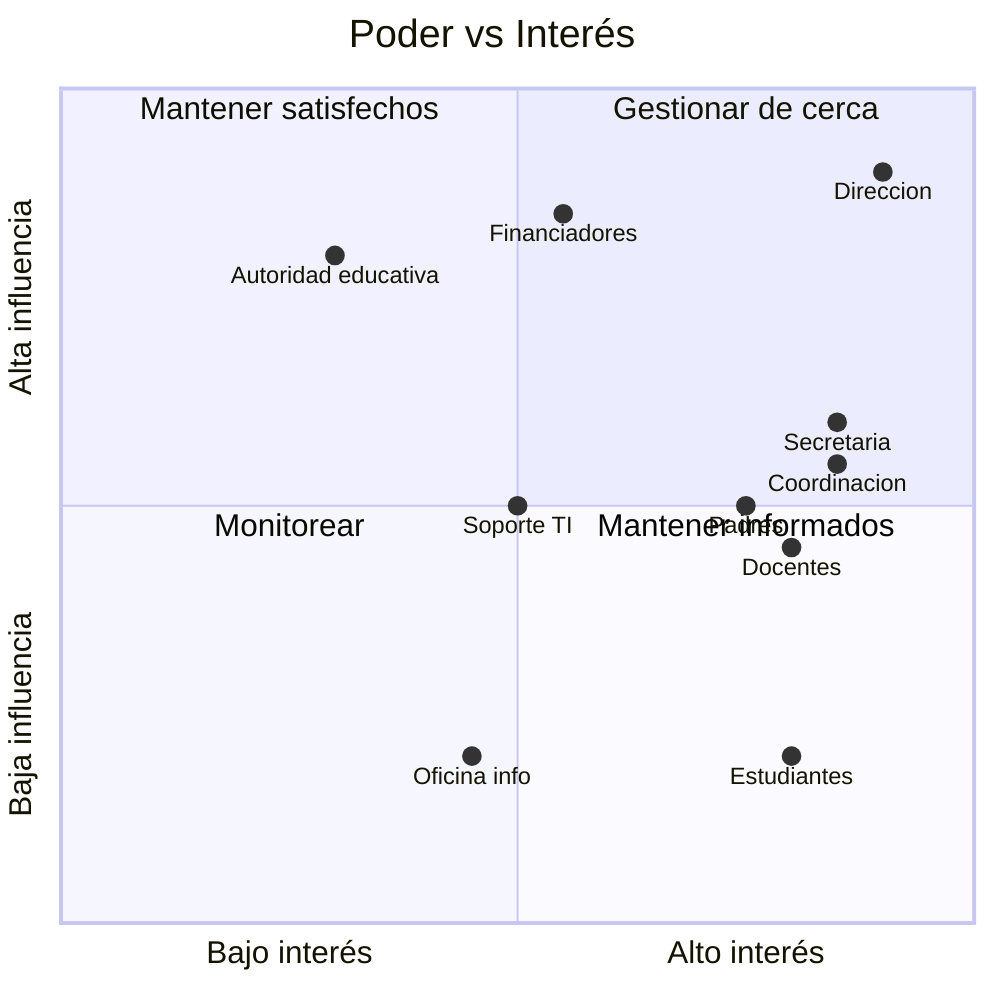

# Stakeholders (partes interesadas)

Volver a [[Inicio]]

| Stakeholder | Interés | Influencia | Necesidad principal | Participa en |
|---|---|---|---|---|
| Dirección del colegio | Alto | Alta | Control, reportes, cumplimiento | [[Sprint Review]] |
| Secretaría académica | Alto | Media | Gestionar personal, matrícula, estructura | Review, refinamiento |
| Coordinación pedagógica | Alto | Media | Asignar docentes/materias, seguimiento | Review, refinamiento |
| Docentes (1–50 en el piloto) | Alto | Media | Acceso simple a sus aulas y materias | Review, pruebas de usabilidad con datos ficticios |
| Soporte TI | Medio | Media | Administración de cuentas, seguridad | Refinamiento técnico |
| Oficina de información | Medio | Baja | Consultar datos para atender al público | Review |
| Estudiantes | Alto | Baja (fase 1) | App fácil, liviana | Pruebas (fase 4) |
| Padres / tutores | Alto | Media | Seguimiento de sus hijos (acceso propio: [[EP-09 Acceso de tutores]]) | Encuestas, pruebas (Fase 4) |
| Cooperación / financiadores del piloto | Medio | Alta | Resultados medibles y documentados | Review de hitos |
| Autoridad educativa | Bajo-medio | Alta | Cumplimiento normativo | Según requiera |

## Mapa de poder / interés

El [[Product Owner]] es quien representa y equilibra estos intereses en el [[Backlog del producto]].
