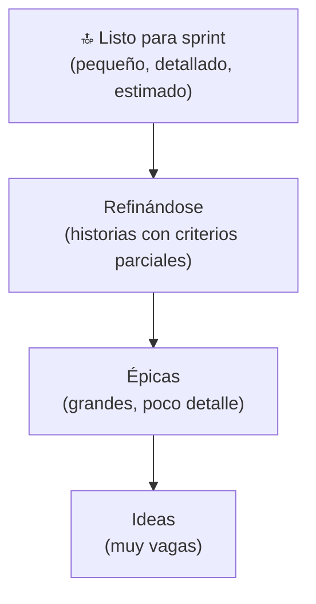

# Product Backlog

Volver a [[Scrum MOC]] · Backlog real del proyecto: [[Backlog del producto]]

Lista **emergente y ordenada** de lo necesario para mejorar el producto. Es la **única fuente de trabajo** del Equipo Scrum.

- **Compromiso:** [[Objetivo del producto]].
- **Dueño:** [[Product Owner]] (lo ordena); todos pueden aportar.
- Los elementos de arriba están más refinados que los de abajo (forma de iceberg).

## Características (DEEP)
- **D**etallado apropiadamente
- **E**stimado
- **E**mergente
- **P**riorizado (ordenado)
