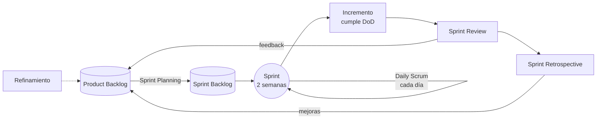

# 🔁 Scrum — Mapa de conocimiento

Volver a [[Inicio]]

> **Scrum** es un marco de trabajo ligero que ayuda a personas, equipos y organizaciones a generar valor a través de soluciones adaptativas para problemas complejos. Se basa en el **empirismo** (el conocimiento viene de la experiencia) y el **pensamiento Lean** (reducir desperdicio, enfocarse en lo esencial). — *Guía de Scrum 2020*

## Teoría
- [[Pilares de Scrum]] — transparencia, inspección, adaptación
- [[Valores de Scrum]] — compromiso, foco, apertura, respeto, coraje

## Equipo Scrum (3 responsabilidades)
- [[Product Owner]] — maximiza el valor del producto
- [[Scrum Master]] — efectividad del equipo y de Scrum
- [[Developers]] — crean el incremento
- Aplicado aquí: [[Equipo Scrum del proyecto]]

## Eventos (5)
| Evento | Timebox (sprint de 1 mes) | En este proyecto (2 semanas) |
|---|---|---|
| [[Sprint]] | ≤ 1 mes | 2 semanas |
| [[Sprint Planning]] | ≤ 8 h | ≤ 4 h |
| [[Daily Scrum]] | 15 min | 15 min |
| [[Sprint Review]] | ≤ 4 h | ≤ 2 h |
| [[Sprint Retrospective]] | ≤ 3 h | ≤ 1,5 h |

Actividad continua (no es evento formal): [[Refinamiento del backlog]].

## Artefactos (3) y sus compromisos
| Artefacto | Compromiso | Aplicado |
|---|---|---|
| [[Product Backlog]] | [[Objetivo del producto]] | [[Backlog del producto]] |
| [[Sprint Backlog]] | [[Objetivo del sprint]] | [[Sprints MOC]] |
| [[Incremento]] | [[Definition of Done]] | [[Definicion de Terminado]] |

## Prácticas complementarias (no obligatorias en la Guía)
- [[Historias de usuario]] · [[Criterios INVEST]] · [[Criterios de aceptacion]]
- [[Estimacion y Planning Poker]]
- [[Definition of Ready]]
- [[Metricas agiles]]
- [[Scrum en proyectos educativos]]
- [[Antipatrones de Scrum]]

## Ciclo de Scrum

