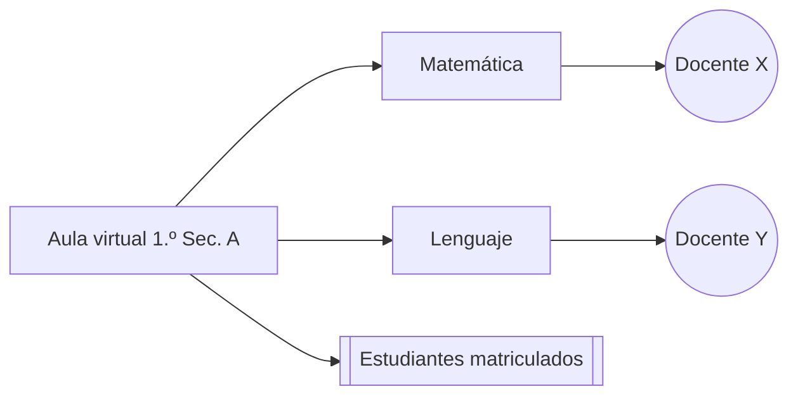

# EP-05 · Asignación de cursos y materias a las aulas virtuales

Volver a [[Backlog del producto]]

## Descripción
Coordinación académica asigna a cada aula virtual sus **materias** y a cada materia su **docente**; secretaría matricula a los **estudiantes** en su aula. Al ingresar, cada docente ve solo sus aulas y materias.

## Historias
- [[HU-020 Asignar materias al aula]] (3)
- [[HU-021 Asignar docente a materia]] (5)
- [[HU-022 Docente ve sus aulas asignadas]] (3)
- [[HU-023 Matricular estudiantes en aula]] (5)

## Reglas de negocio
- Un docente puede tener varias materias en varias aulas.
- Una materia de un aula tiene un docente titular (y opcionalmente un suplente).
- Un estudiante está matriculado en una sola aula por gestión.
- Las asignaciones pertenecen a una gestión; al cerrar la gestión quedan como histórico.

## Relacionado
[[Modelo de dominio]] · [[Roles y permisos RBAC]]
