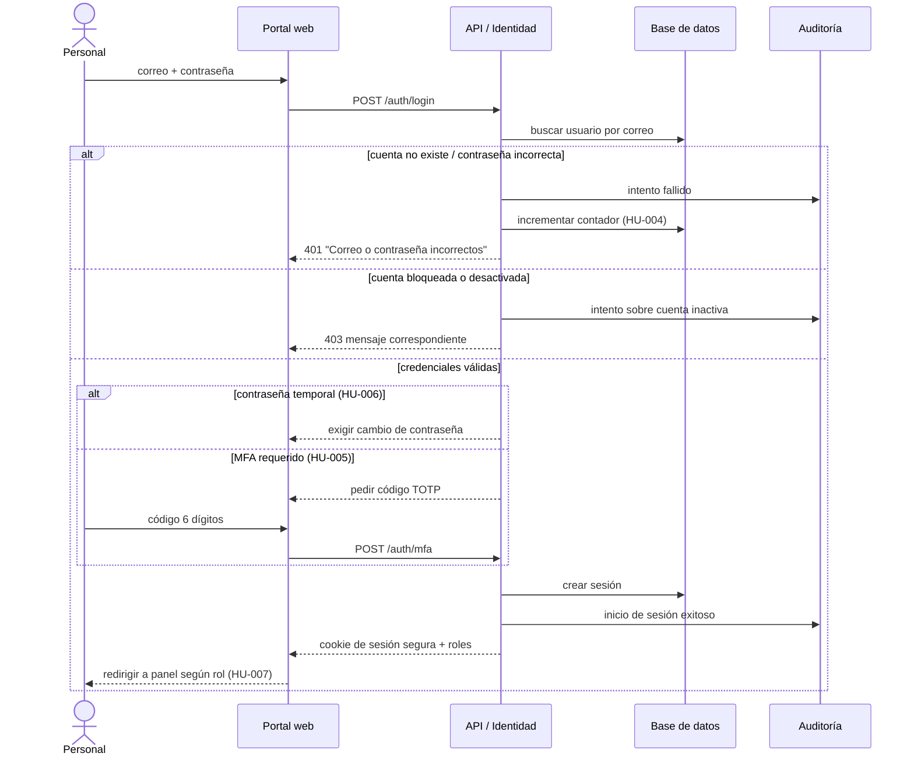
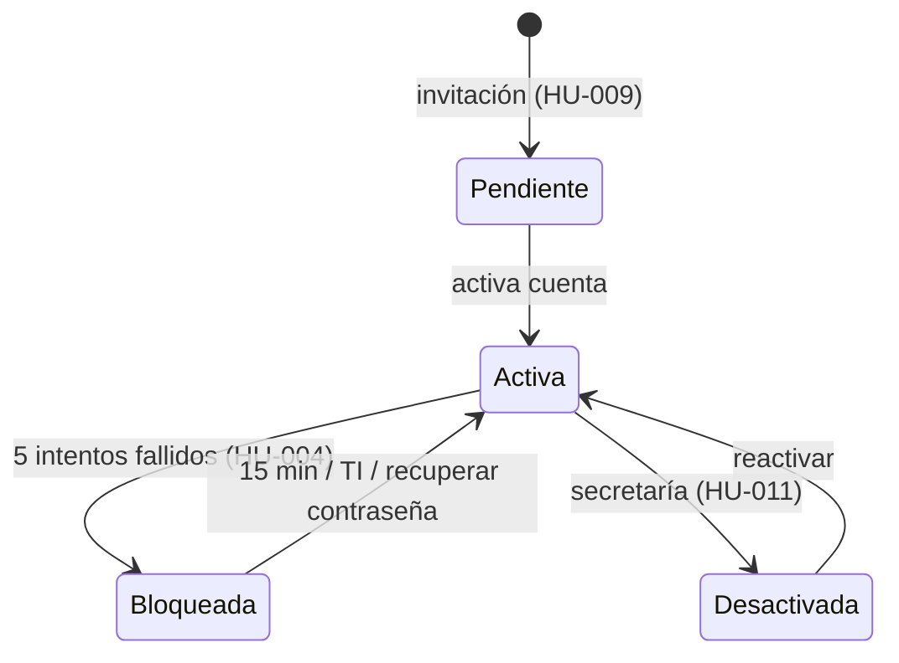

# Flujo de autenticación del personal

Volver a [[Vision de arquitectura]] · Épica: [[EP-01 Login plantel administrativo y docentes]]

## Secuencia

## Estados de la cuenta

## Decisiones clave
- Sesión con cookie `HttpOnly`, `Secure`, `SameSite`; expiración por inactividad 30 min ([[HU-002 Cerrar sesion]]).
- Mensajes de error genéricos para no revelar existencia de cuentas.
- Ver [[ADR-002 Autenticacion con correo institucional y MFA]].
