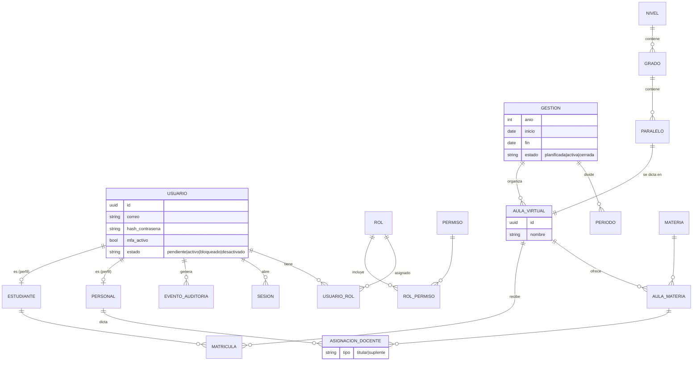

# Modelo de dominio

Volver a [[Vision de arquitectura]]

## Notas
- **Usuario** = identidad para autenticarse; **Personal** / **Estudiante** = perfiles con datos de negocio. Permite una sola tabla de identidad con flujos de acceso separados ([[ADR-003 Separar acceso de personal y estudiantes]]).
- Todo lo académico cuelga de **Gestión** para conservar el histórico año a año.
- Niveles/grados configurables ([[Marco normativo Bolivia]]).
- Fase 1 implementa solo: USUARIO, ROL, PERMISO, USUARIO_ROL, ROL_PERMISO, SESION, EVENTO_AUDITORIA, PERSONAL.
