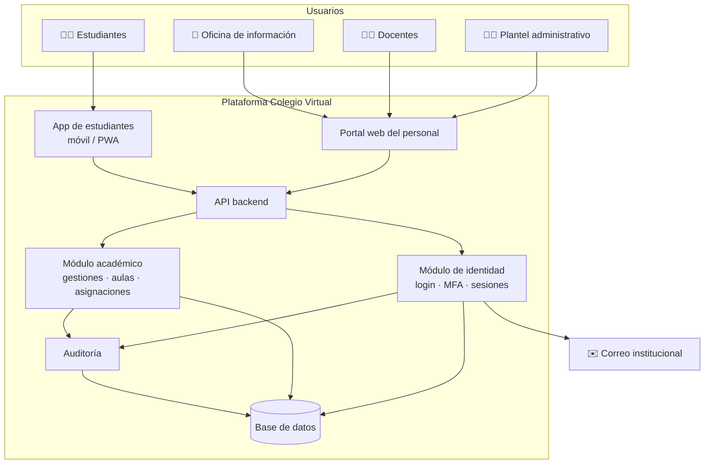

# 🏗️ Visión de arquitectura

Volver a [[Inicio]]

> Propuesta inicial, **tecnológicamente neutral**. La elección concreta de stack se registra como ADR en el [[Sprint 0 - Preparacion]].

## Vista de contexto

## Módulos
| Módulo | Responsabilidad | Épicas |
|---|---|---|
| Identidad y acceso | Login, contraseñas, MFA, sesiones, roles | [[EP-01 Login plantel administrativo y docentes]], [[EP-02 Gestion de usuarios y roles]] |
| Académico | Gestiones, niveles, grados, paralelos, materias, aulas, asignaciones, matrícula | [[EP-03 Estructura academica]], [[EP-04 Aulas virtuales]], [[EP-05 Asignacion de cursos y materias]] |
| App estudiantes | Cliente móvil liviano | [[EP-06 App de estudiantes]] |
| Atención | Oficina de información | [[EP-07 Oficina de informacion]] |
| Auditoría | Bitácora inmutable | [[EP-08 Seguridad y auditoria]] |

## Notas de diseño
- [[Modelo de dominio]]
- [[Roles y permisos RBAC]]
- [[Flujo de autenticacion]]
- [[Requisitos no funcionales]]
- [[Seguridad y proteccion de datos]]

## Decisiones (ADR)
- [[ADR-001 Plataforma 100 por ciento virtual web y movil]]
- [[ADR-002 Autenticacion con correo institucional y MFA]]
- [[ADR-003 Separar acceso de personal y estudiantes]]
- [[ADR-004 Control de acceso basado en roles]]

## Criterios para elegir stack (para el ADR del Sprint 0)
- Conocimiento del equipo y facilidad de contratar en el medio local.
- Bibliotecas maduras de autenticación (hash de contraseñas, TOTP, sesiones).
- Costo de hosting y posibilidad de alojamiento local/regional.
- Soporte de PWA o desarrollo móvil multiplataforma.
- Comunidad y soporte a largo plazo.
