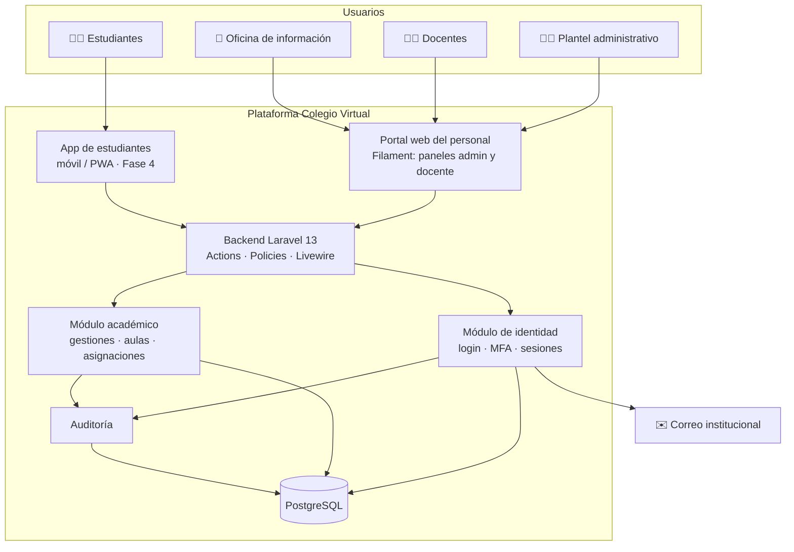

# 🏗️ Visión de arquitectura

Volver a [[Inicio]]

> Stack decidido en el [[Sprint 0 - Preparacion]]: **PHP 8.3 + Laravel 13 + Filament 5** con PostgreSQL. Ver [[ADR-005 Stack PHP Laravel y Filament]] y la guía práctica [[Stack tecnologico]].

## Vista de contexto

## Módulos
| Módulo | Responsabilidad | Épicas |
|---|---|---|
| Identidad y acceso | Login, contraseñas, MFA, sesiones, roles | [[EP-01 Login plantel administrativo y docentes]], [[EP-02 Gestion de usuarios y roles]] |
| Académico | Gestiones, niveles, grados, paralelos, materias, aulas, asignaciones, matrícula | [[EP-03 Estructura academica]], [[EP-04 Aulas virtuales]], [[EP-05 Asignacion de cursos y materias]] |
| App estudiantes | Cliente móvil liviano | [[EP-06 App de estudiantes]] |
| Atención | Oficina de información | [[EP-07 Oficina de informacion]] |
| Auditoría | Bitácora inmutable | [[EP-08 Seguridad y auditoria]] |

## Stack tecnológico
| Capa | Elección |
|---|---|
| Lenguaje / framework | PHP 8.3+ · Laravel 13 |
| Portal del personal (frontend + backend) | Filament 5 (Livewire 4, Alpine.js, Tailwind CSS 4), paneles `admin` y `docente` |
| Base de datos | PostgreSQL 16+ (SQLite en memoria para pruebas) |
| Autenticación | Login de Filament personalizado (correo institucional), MFA TOTP nativo de Filament, sesiones en base de datos |
| Autorización | `spatie/laravel-permission` + Policies de Laravel |
| Auditoría | Tabla propia `audit_events` inmutable |
| Calidad | Pest 4, Larastan nivel 6, Pint, GitHub Actions |
| App de estudiantes (Fase 4) | Decisión abierta: panel Filament PWA vs. API Sanctum + app móvil |
| Código | Carpeta `app-colegio/` en la raíz del repositorio, separada del vault |

Detalle y justificación: [[ADR-005 Stack PHP Laravel y Filament]] · Versiones, convenciones y mapeo de historias: [[Stack tecnologico]].

## Notas de diseño
- [[Stack tecnologico]]
- [[Modelo de dominio]]
- [[Roles y permisos RBAC]]
- [[Flujo de autenticacion]]
- [[Requisitos no funcionales]]
- [[Seguridad y proteccion de datos]]

## Decisiones (ADR)
- [[ADR-001 Plataforma 100 por ciento virtual web y movil]]
- [[ADR-002 Autenticacion con correo institucional y MFA]]
- [[ADR-003 Separar acceso de personal y estudiantes]]
- [[ADR-004 Control de acceso basado en roles]]
- [[ADR-005 Stack PHP Laravel y Filament]]

## Criterios usados para elegir el stack (ver ADR-005)
- Conocimiento del equipo y facilidad de contratar en el medio local.
- Bibliotecas maduras de autenticación (hash de contraseñas, TOTP, sesiones).
- Costo de hosting y posibilidad de alojamiento local/regional.
- Soporte de PWA o desarrollo móvil multiplataforma.
- Comunidad y soporte a largo plazo.
